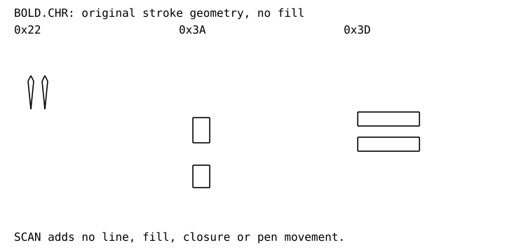

# BGI Stroked Fonts (`.CHR`)

[◀ Prev: Icon Format](3.0-icon-format.md) · [Contents](README.md) · [Next: Bitmap Fonts ▶](3.2-bitmap-fonts.md)

RIPscrip's scalable fonts 1-10 are Borland Graphics Interface (BGI) **stroked fonts**: each glyph is a sequence of move/draw vector strokes, scaled at render time, in the same format as Borland's BGI Toolkit (1987-89).

## Font number mapping

[RIP_FONT_STYLE](../ripscrip/3.0-text-output-and-fonts.md#rip_font_style) (`!|Y <font:2> <direction:2> <size:2> <res:2>`) selects the typeface for [RIP_TEXT](../ripscrip/3.0-text-output-and-fonts.md#rip_text)/[RIP_TEXT_XY](../ripscrip/3.0-text-output-and-fonts.md#rip_text_xy). Font 0 is the bitmap default (see [Bitmap Fonts](3.2-bitmap-fonts.md)); fonts 1-10 map to the `.CHR` files. RIPterm 1.54 shipped these as ten `.CHR` files in its `FONTS\` sub-directory (preserved byte-exact in [`version/1.54/assets/fonts/`](../../1.54/assets/fonts/README.md)); WHATSNEW.DOC notes they were externalized to disk precisely so they would be "easily editable with any available Borland BGI font editor". The file assignment is fixed by RIPTERM.DOC's file list and matches the classic Borland font IDs (`RIPtermJS:src/BGI.js`, `BGI.fontFileList`):

| Font # (meganum) | File | Typeface (spec / RIPTERM.DOC) | Borland ID |
| --- | --- | --- | --- |
| `01` | `TRIP.CHR` | Triplex Font | `TRIPLEX_FONT` (1) |
| `02` | `LITT.CHR` | Small Font | `SMALL_FONT` (2) |
| `03` | `SANS.CHR` | Sans Serif Font | `SANSSERIF_FONT` (3) |
| `04` | `GOTH.CHR` | Gothic [Old English] Font | `GOTHIC_FONT` (4) |
| `05` | `SCRI.CHR` | Script Font | `SCRIPT_FONT` (5) |
| `06` | `SIMP.CHR` | Simplex Font | `SIMPLEX_FONT` (6) |
| `07` | `TSCR.CHR` | Triplex Script Font | `TRIPLEX_SCR_FONT` (7) |
| `08` | `LCOM.CHR` | Complex Font | `COMPLEX_FONT` (8) |
| `09` | `EURO.CHR` | European Font | `EUROPEAN_FONT` (9) |
| `0A` | `BOLD.CHR` | Bold Font | `BOLD_FONT` (10) |

## File structure

A `.CHR` file has three parts: a text prefix header, a binary stroke-file header, and the glyph tables/stroke data.

### Prefix header (offset 0)

```text
offset 0:      "PK\b\b"                       4-byte signature (50 4B 08 08)
offset 4:      description text               e.g. "BGI Stroked Font V1.1 - Jun 5, 1989\r\n
                                              Copyright (c) 1987,1988 Borland International\r\n"
               0x1A                           DOS EOF byte terminates the text
EOF+1:         uint16 header_size             offset of the stroke-file header (0x0080 in all shipped files)
EOF+3:         char   font_name[4]            internal name: "TRIP", "LITT", ...
EOF+7:         uint16 font_data_size          size of everything from header_size to end of file
EOF+9:         uint8  version_major, version_minor      driver version (1, 0 in all shipped files)
EOF+11:        uint8  min_version_major, min_version_minor   minimum BGI revision (1, 0)
               zero padding up to header_size
```

Verified against `../../1.54/assets/fonts/TRIP.CHR`: bytes at the 0x1A terminator read `1a 80 00 54 52 49 50 a5 40 01 00 01 00` - header size 0x0080, name `TRIP`, data size 0x40A5 = 16,549, and 128 + 16,549 = 16,677 = the exact file size. The `header_size + font_data_size = file_size` identity holds for all ten shipped fonts (decoded programmatically; see the table below).

### Stroke-file header (offset `header_size`, 16 bytes)

```c
struct chr_stroke_header {          /* at offset 0x80 in all shipped files */
    char     sig;                   /* '+' (0x2B) marks a stroke font      */
    uint16_t nchars;                /* number of glyphs in the font        */
    char     undefined;
    uint8_t  firstchar;             /* ASCII code of the first glyph       */
    uint16_t cdefs;                 /* offset of stroke data, relative to
                                       the stroke-file header              */
    uint8_t  scan_flag;             /* 0 in all shipped files              */
    int8_t   org_to_cap;            /* baseline to capital top (px, up +)  */
    int8_t   org_to_base;           /* baseline offset (0 in all files)    */
    int8_t   org_to_dec;            /* baseline to descender bottom (neg.) */
    char     name[4];               /* unused; not required to be zero      */
    char     unused;
};
```

**Observed-byte correction:** the unused `name[4]` field is not uniformly zero. TSCR.CHR contains **02 03 00 00** at stroke-header +11..+14 (file **0x8B..0x8E**). Its internal font name still comes from the prefix header; no meaning is assigned here to these unused bytes. The byte-exact TSCR payload has SHA-256 `305e2a9657902fef2a52b25e398a5e2fca4cd0ace0fc0208704b2cb5c360b187` and is pinned identically in the 1.54 and 3.0 asset trees. _Evidence: original file and [hash/header census](../../3.0/research/issue-17-chr-scan-records.md#recovered-bytes-and-census)._

Field roles per Borland's BGI Toolkit documentation; offsets and values verified by parsing all ten shipped files (reader implementations agree: `RIPtermJS:src/BGI.js` `fetchCHRFont()` reads `numchars` at 0x81, `firstchar` at 0x84, `cdefs` at 0x85, metrics at 0x88-0x8A; `sbbs:src/syncterm/ripper.c` `char_width_raw()` and `write_char()` use the same offsets into its embedded font images).

Immediately after the header:

- `uint16 char_offsets[nchars]` (at header + 16, i.e. file offset 0x90) - each glyph's stroke-data offset relative to `cdefs`. Offsets may repeat: glyphs can share a definition (observed in `SANS.CHR`; noted in `RIPtermJS:src/BGI.js` `fetchCHRFont()`).
- `uint8 char_widths[nchars]` - per-glyph advance widths in unscaled stroke units.
- Stroke data from `header_size + cdefs` to end of file.

Layout self-check: 16 + 2·nchars + nchars = `cdefs` in every shipped file (e.g. TRIP: 16 + 446 + 223 = 685 = 0x2AD).

### Decoded headers of the ten shipped fonts

| File | `nchars` | `firstchar` | `cdefs` | `org_to_cap` | `org_to_base` | `org_to_dec` | data size | file size |
| --- | --: | --- | --- | --: | --: | --: | --: | --: |
| `TRIP.CHR` | 223 | 0x20 `' '` | 0x02AD | 24 | 0 | -7 | 16,549 | 16,677 |
| `LITT.CHR` | 223 | 0x20 | 0x02AD | 7 | 0 | -2 | 5,003 | 5,131 |
| `SANS.CHR` | 254 | 0x01 | 0x030A | 25 | 0 | -7 | 13,468 | 13,596 |
| `GOTH.CHR` | 223 | 0x20 | 0x02AD | 25 | 0 | -7 | 17,935 | 18,063 |
| `SCRI.CHR` | 223 | 0x20 | 0x02AD | 25 | 0 | -12 | 10,859 | 10,987 |
| `SIMP.CHR` | 223 | 0x20 | 0x02AD | 28 | 0 | -7 | 8,309 | 8,437 |
| `TSCR.CHR` | 223 | 0x20 | 0x02AD | 24 | 0 | -7 | 17,227 | 17,355 |
| `LCOM.CHR` | 223 | 0x20 | 0x02AD | 28 | 0 | -7 | 11,955 | 12,083 |
| `EURO.CHR` | 223 | 0x20 | 0x02AD | 45 | 0 | -10 | 8,311 | 8,439 |
| `BOLD.CHR` | 224 | 0x20 | 0x02B0 | 53 | 0 | -7 | 14,542 | 14,670 |

(All: header size 128, version 1.0, `scan_flag` 0. Most fonts cover chars 0x20-0xFE; `SANS.CHR` unusually starts at char 0x01.)

## Stroke opcodes

Stroke data is a sequence of 2-byte records. The high bit of each byte forms a 2-bit opcode; for MOVE/DRAW, the low 7 bits of each byte are a **signed 7-bit two's-complement** coordinate (-64…+63):

| bit 7 of byte 1 | bit 7 of byte 2 | Operation |
| --- | --- | --- |
| 0 | 0 | End of glyph definition |
| 1 | 0 | Move pen to (x, y) |
| 1 | 1 | Draw line from current pen position to (x, y) |
| 0 | 1 | SCAN / “do scan”; emitted in BOLD.CHR; consumed without painting by RIPtel 3.1 (see below) |

- For MOVE/DRAW: x = byte 1 & 0x7F, y = byte 2 & 0x7F, both sign-extended from 7 bits.
- Coordinates are absolute within the glyph, relative to the glyph origin at the **baseline** left edge, with **y positive upward** (Borland convention; renderers negate y for screen space - `RIPtermJS:src/BGI.js` `drawChar()` computes `y = y0 - dy`; `sbbs:src/syncterm/ripper.c` `write_char()` likewise subtracts the y stroke term).
- Decoder evidence: `RIPtermJS:src/BGI.js` `fetchCHRFont()`/`drawChar()`; `sbbs:src/syncterm/ripper.c` `write_char()`.

### SCAN records and RIPtel rendering

The earlier “never emitted” assertion was incorrect. The byte-exact BOLD.CHR payload pinned in both the 1.54 and 3.0 asset trees is **14,670 bytes**, SHA-256 `ee8b45d7491e1bc61936923f8642f1766c58dee7c528fa542e727092a914d07e`. A complete valid-glyph walk reaches six `00 80` SCAN records:

| Character code | Full-file byte offset | Offset within glyph program |
| -------------- | --------------------- | --------------------------- |
| 0x22 (`"`)     | 0x035A                | 10                          |
| 0x25 (`%`)     | 0x043C                | 32                          |
| 0x25 (`%`)     | 0x045E                | 66                          |
| 0x3A (`:`)     | 0x0902                | 10                          |
| 0x3B (`;`)     | 0x091E                | 12                          |
| 0x3D (`=`)     | 0x0946                | 10                          |

Every one is followed by MOVE. The other nine RIPtel CHR files contain no SCAN records reached through their glyph tables. This census preserves the raw opcode; it does not reinterpret it as a MOVE or END.

**RIPtel 3.1 / RIPscrip driver 3.0.7 painting contract:** consume the two SCAN bytes and continue to the next record in the same glyph. SCAN paints nothing and leaves pen position, contour state and advance unchanged. It does not fill or scan-convert a preceding closed region, add a closing edge, connect contours, flush strokes or terminate the glyph. Its low seven-bit payload values are ignored. The original horizontal and vertical glyph loops branch only for END/MOVE/DRAW; SCAN takes the default continuation path. This is original-client evidence, separate from a peer decoder's IGNORE choice, and does not claim a runtime result for earlier Borland/RIPterm clients.

`scan_flag` is **0 in all ten RIPtel fonts**. RIPtel's original classic loader and glyph consumer do not use it to enable scanning or filling. Setting it to any other byte value before loading leaves these glyphs' drawing and state unchanged. Thus these records are no-ops regardless of that flag, rather than active scan operations suppressed specifically by zero.

For a geometric oracle at unit stroke scale (RIP size 4):

| Glyph | Explicit contours in glyph coordinates (y positive upward) | RIPtel result |
| --- | --- | --- |
| Quote 0x22 | `(0,38)->(1,28)->(2,38)->(1,40)->(0,38)` and the same contour shifted +5 in x | Two narrow closed outlines; SCAN between them adds nothing |
| Colon 0x3A | Rectangles x=0..6, y=0..8 and y=16..25 | Two rectangular outlines, with unpainted interiors |
| Equals 0x3D | Rectangles x=0..22, y=13..18 and y=22..27 | Two outlined bars, with unpainted interiors |

Each of these glyphs issues eight explicit line edges; the stream itself closes each contour with DRAW back to its start. A final MOVE goes to its advance position. The SCAN supplies neither closure nor fill. The figure below is generated from original MoveToEx/LineTo arguments; its display scaling illustrates geometry and does not reproduce Windows rasterization.



_Evidence: [complete original instruction trace, native probe and scope](../../3.0/research/issue-17-chr-scan-records.md#original-glyph-path-and-scan-decision). The hash-guarded `run/riptel-chr-probe` executes original loading/drawing, compares SCAN removal across every original glyph-table entry, tests all 256 scan_flag values before loading and all 16,384 SCAN payload pairs between DRAWs, and verifies the affected ASCII glyphs through the original string consumer. Its SVG-producing invocation passes 13,518,407 checks without GUI or source-font mutation._

### Worked example: `LITT.CHR` glyph `'A'`

Advance width 6; stroke data at file offset 0x05A3 (= 0x80 + `cdefs` 0x2AD + per-glyph offset 630):

```text
80 00   MOVE  ( 0, 0)      pen to baseline-left
80 84   DRAW  ( 0, 4)      left stem up
82 86   DRAW  ( 2, 6)      to apex
84 84   DRAW  ( 4, 4)      right slope down
84 80   DRAW  ( 4, 0)      right stem to baseline
84 83   DRAW  ( 4, 3)      back up right stem
80 83   DRAW  ( 0, 3)      crossbar
86 00   MOVE  ( 6, 0)      pen to next-glyph origin
00 00   END
```

(Decoded from `../../1.54/assets/fonts/LITT.CHR` with the tables above; the final MOVE to (width, 0) before END is a common but not universal pattern in these fonts.)

## Scaling: RIP size vs. actual magnification

RIP_FONT_STYLE's `<size>` parameter (01-0A) is passed straight through to BGI's `settextstyle()` charsize, and BGI charsize is **not** a linear multiplier. The spec's claim that "01 [is] the normal default size, 02 for x2 magnification, … 0A for x10" is only true of bitmap font 0; for stroked fonts the real factors are Borland's charsize ratios, with **size 4 being 1:1 stroke units**:

| RIP size | 1   | 2   | 3   | 4   | 5   | 6   | 7   | 8   | 9   | 10  |
| -------- | --- | --- | --- | --- | --- | --- | --- | --- | --- | --- |
| Factor   | 3/5 | 2/3 | 3/4 | 1   | 4/3 | 5/3 | 2   | 5/2 | 3   | 4   |

Sources: `sbbs:src/syncterm/ripper.c` `stroke_mults[11] = {1,3,2,3,1,4,5,2,5,3,4}` / `stroke_divs[11] = {1,5,3,4,1,3,3,1,2,1,1}` (index = RIP size); `RIPtermJS:src/BGI.js` `BGI.fontScales = [1, 0.6, 2/3, 0.75, 1, 4/3, 5/3, 2, 2.5, 3, 4]`. These are the standard Turbo C BGI charsize tables. Text width is computed sum-then-scale - add up the unscaled glyph widths, then apply mult/div once (`sbbs:src/syncterm/ripper.c` `textwidth()` comment: "sum-then-scale, matching" BGI) - which avoids per-character rounding drift.

Character height for layout purposes is `org_to_cap - org_to_dec` scaled by the same factor (`sbbs:src/syncterm/ripper.c` `font_height()`; `RIPtermJS:src/BGI.js` `textheight()` uses `font.top`/`font.bottom` similarly).

## `EGAVGA.BGI` and the rendering pipeline

RIPterm 1.54 does **not** ship any `.BGI` driver file - the RIPTERM.DOC distribution file list contains only the `.CHR` fonts and `RIPTERM.FNT`. The Borland EGA/VGA display driver is linked into the executable: `RIPTERM.EXE` embeds the strings `BGI Device Driver (EGAVGA) 2.00 - Mar 21 1988` and `Copyright (c) 1987,1988 Borland International` (observed via `strings` on `~/src/rip-tools/RIPterm154/DOS/RIPTERM/RIPTERM.EXE`), i.e. EGAVGA.BGI converted with Borland's `BGIOBJ` and registered at link time. RIPterm runs the driver's 640x350x16 EGAHI mode, which is why RIPscrip 1.54 coordinates are 640x350 (`RIPScrip-1.54.txt`: "Coordinates are specified based on a 640x350 pixel resolution").

Practical consequences for re-implementers:

- Stroked text is drawn as vectors through the same line-drawing state machine as everything else, but always with solid 1-pixel lines regardless of the current line style; only the current drawing color and write mode apply (`RIPtermJS:src/BGI.js` `drawChar()` calls `lineto(..., SOLID_LINE, NORM_WIDTH)`; see [Canvas, Clipping & Write Modes](2.0-canvas-clipping-write-modes.md) for write-mode details).
- Glyph metrics, kerning (none - pure advance widths), and scaling must reproduce BGI's integer arithmetic to match RIPterm pixel-for-pixel.

---

[◀ Prev: Icon Format](3.0-icon-format.md) · [Contents](README.md) · [Next: Bitmap Fonts ▶](3.2-bitmap-fonts.md)
